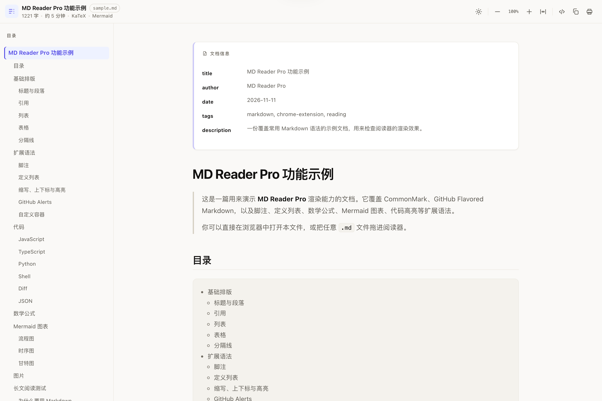
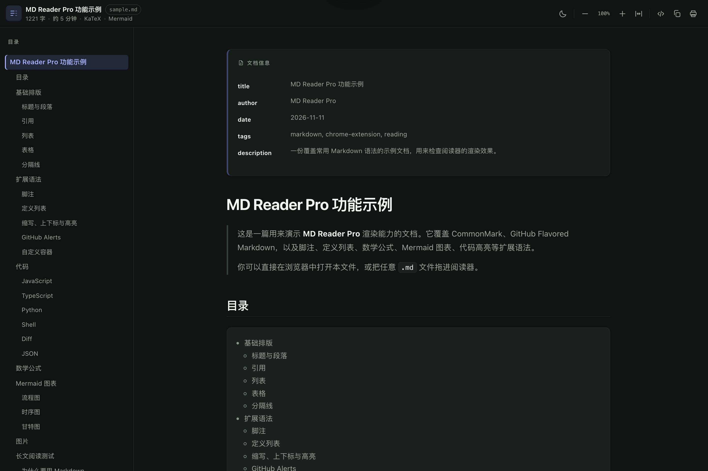
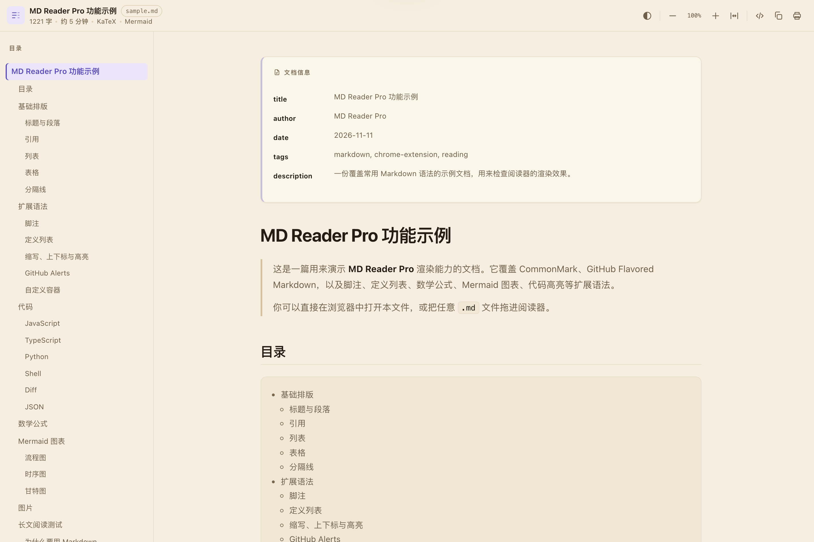
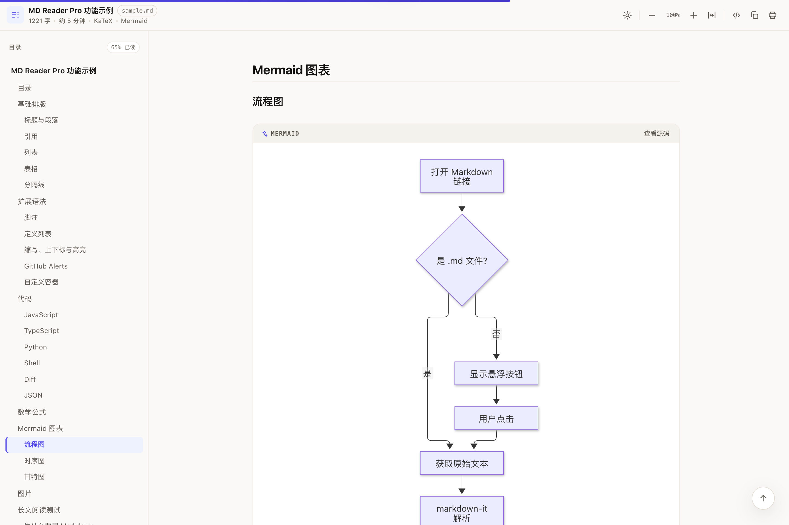
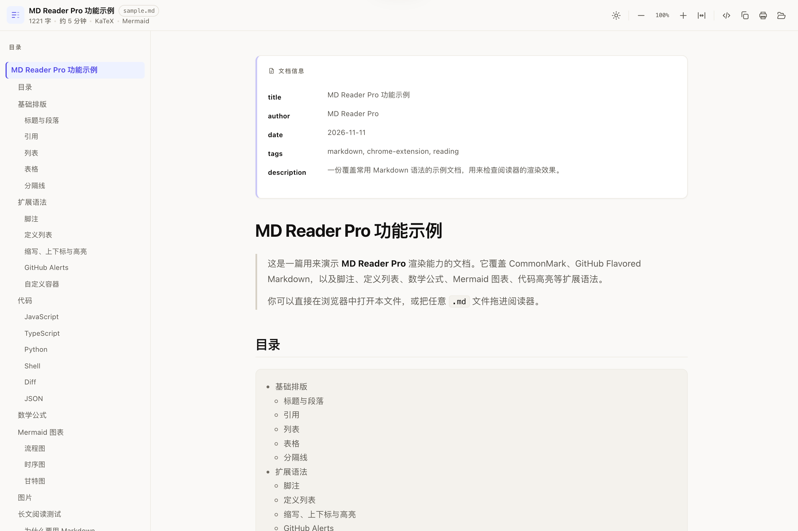
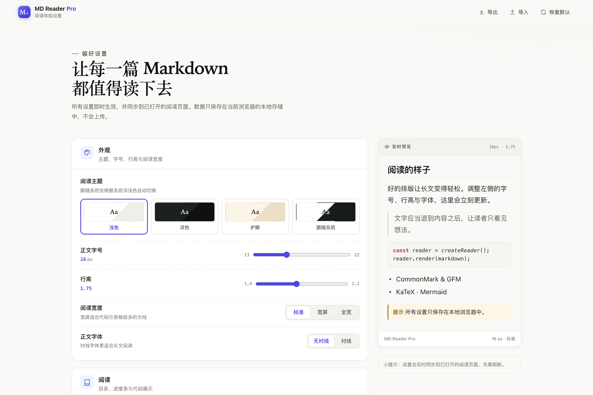
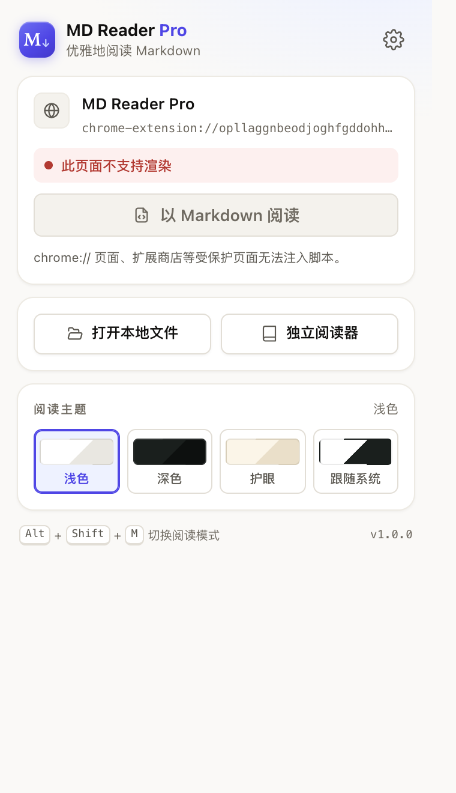
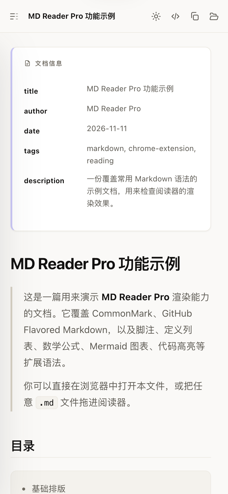

# MD Reader Pro

把浏览器里的 Markdown 变成一篇真正好读的文章。

[](https://github.com/Hanice404/md-reader-pro/actions/workflows/build.yml)
[](https://github.com/Hanice404/md-reader-pro/releases)
[](LICENSE)

**项目地址：** <https://github.com/Hanice404/md-reader-pro>

## 简介

MD Reader Pro 是一个完全离线的 Chrome 扩展：打开 `.md` 链接、本地 Markdown 文件或任意纯文本页面，即可获得带目录、代码高亮、数学公式、Mermaid 图表和多套主题的阅读界面。所有解析与渲染都在本地完成，文档内容不会离开你的浏览器。

**版本：** v1.0.0 ｜ **兼容：** Chrome 110+ / Edge 110+（Chromium 内核，不支持 Firefox）

## 截图

| 浅色主题 | 深色主题 |
| --- | --- |
|  |  |

| 护眼主题 | Mermaid 图表 |
| --- | --- |
|  |  |

| 独立阅读器 | 设置页 |
| --- | --- |
|  |  |

| 工具栏弹窗 | 移动端阅读 |
| --- | --- |
|  |  |

## 特性

- **自动识别 Markdown**：`text/markdown` 内容类型、以 `.md` / `.markdown` / `.mdown` / `.mkd` / `.mdx` 结尾的链接（大小写、query、hash 均可），以及 GitHub / GitLab / Gitee / Bitbucket 等 raw 地址。
- **不会误伤网页**：即使 URL 以 `.md` 结尾，只要是 `text/html` 页面就绝不自动接管；PDF、`view-source:`、`chrome://` 等受保护页面会直接跳过。
- **纯文本提示**：`text/plain` 页面被检测到 2 类以上 Markdown 特征时，右下角出现悬浮按钮，点击才进入阅读模式。
- **专业阅读体验**：顶部工具栏与侧边目录固定，正文独立滚动；右上角 − / + 之间显示字号百分比，点击即恢复 100%；自动目录与滚动高亮、阅读进度、代码复制、图片灯箱、回到顶部、打印 / 导出 PDF、源码切换、Markdown 复制。
- **四种主题**：浅色、深色、护眼、跟随系统；字号、行高、阅读宽度与衬线 / 无衬线字体均可调节。
- **完整渲染能力**：CommonMark + GFM、脚注、定义列表、缩写、上下标、`==高亮==`、任务列表、GitHub Alerts、多行表格、YAML front matter、KaTeX 数学公式、Mermaid 图表与 highlight.js 代码高亮。
- **清爽表格**：浅色实线网格、表头底色、对齐方式、行内代码/公式，宽表格横向滚动。
- **安全的富文本**：原始 HTML 经 DOMPurify 清洗，移除 `<script>`、事件属性、`javascript:` 链接与 iframe。
- **独立阅读器**：无需先安装扩展也能在阅读器页面拖拽文件、粘贴文本、打开在线 Markdown 链接。
- **实时刷新（可选）**：为 http/https 文档开启轮询，源文件变化时自动重新渲染。
- **本地优先、零遥测**：没有账号、没有统计、没有远程代码；除文档自身引用的图片外不发起网络请求。

## 安装

### 方式一：下载 Release（推荐）

1. 打开 [Releases](https://github.com/Hanice404/md-reader-pro/releases/latest)，下载 `md-reader-pro-v1.0.0.zip`。
2. 解压到任意目录（压缩包根目录包含 `manifest.json`）。
3. 打开 `chrome://extensions`（Edge 为 `edge://extensions`），开启右上角的 **开发者模式**。
4. 点击 **加载已解压的扩展程序**，选择解压后的文件夹。
5. 把 MD Reader Pro 固定到工具栏，方便随时使用。

### 方式二：从源码构建

```bash
git clone https://github.com/Hanice404/md-reader-pro.git
cd md-reader-pro
npm install
npm run build
```

构建产物位于 `dist/`。Chrome 只能加载构建后的目录，不能直接加载 `src/`；在扩展管理页点击 **加载已解压的扩展程序**，选择 `dist/` 即可。

升级版本时，先执行 `npm run build`，再到扩展管理页点击该扩展的 **重新加载**。

### 允许访问文件网址（可选）

直接双击打开本地 `file://` 下的 `.md` 文件需要这一步：

1. 在 `chrome://extensions` 找到 MD Reader Pro，点击 **详情**。
2. 打开 **允许访问文件网址**。
3. 重新打开本地 Markdown 文件。

不开启该权限也可以使用工具栏弹窗中的 **打开本地 Markdown 文件**，或把文件拖进独立阅读器。

## 使用方法

### 在线 Markdown

直接访问任意 `.md` 链接即可自动进入阅读模式，例如：

- `https://raw.githubusercontent.com/user/repo/main/README.md`
- `https://gitlab.com/user/repo/-/raw/main/docs/guide.md`
- `https://gitee.com/user/repo/raw/master/README.md`
- Gist raw、GitHub `/raw/` 地址

### 本地文件

开启文件访问权限后，直接打开 `file:///Users/you/notes.md`；也可以在弹窗里点击 **打开本地 Markdown 文件**，或把文件拖入独立阅读器。

### 独立阅读器

点击工具栏图标 → **打开独立阅读器**，或访问 `chrome-extension://<扩展 ID>/viewer.html`。阅读器支持：

- 拖拽 / 选择本地 `.md` 文件；
- 粘贴剪贴板中的 Markdown 文本；
- `viewer.html?url=https://example.com/doc.md` 打开在线文档；
- 查看内置示例文档。

### 快捷键与右键菜单

| 入口 | 操作 |
| --- | --- |
| 快捷键 | `Alt + Shift + M`：以 Markdown 阅读当前页面；已进入阅读模式时切换源码 / 阅读视图 |
| 右键菜单 | 在页面任意处右键 → **以 Markdown 阅读** |
| 工具栏弹窗 | 检测当前页面并一键阅读、切换主题、打开本地文件或独立阅读器 |
| 纯文本提示 | 点击右下角 **以 Markdown 阅读** 悬浮按钮（`Esc` 可关闭） |

### 支持手动接管任意页面

对于没有被自动识别的页面（例如普通文章页、`text/plain` 接口返回），可以用快捷键、右键菜单或弹窗强制进入阅读模式；外壳会提取页面可见文本作为 Markdown 渲染。

## 支持的语法

| 类别 | 支持内容 |
| --- | --- |
| 基础 Markdown | ATX / Setext 标题、段落、粗体 / 斜体 / 粗斜体、删除线、行内代码、链接、图片、引用（可嵌套）、有序 / 无序 / 嵌套列表、水平线、自动链接、HTML 实体 |
| GFM | 表格（含对齐、单元格内代码与公式）、任务列表、删除线、URL 自动链接 |
| 扩展语法 | 脚注、定义列表、缩写、上标 / 下标、`++插入++`、`==高亮==`、`:emoji:` 短代码、`[[toc]]` 内联目录、`{#id .class key=value}` 属性、`::: tip` 容器、GitHub Alerts（`> [!NOTE]`） |
| 表格增强 | 多行表格、合并单元格（rowspan / colspan） |
| 文档元数据 | YAML front matter，可显示为信息卡片、隐藏或保留原文 |
| 数学公式 | `$...$`、`$$...$$`、`\(...\)`、`\[...\]`，由 KaTeX 渲染（`throwOnError: false`） |
| 图表 | ` ```mermaid ` 流程图、时序图、甘特图、类图、状态图、ER 图、饼图、时间线等，按需异步加载 |
| 代码 | highlight.js 常见语言高亮、语言标签、一键复制、可选行号与自动换行 |
| 安全 | DOMPurify 清洗原始 HTML；禁止脚本、事件属性、`javascript:`；KaTeX `trust:false`；Mermaid `securityLevel:'strict'` |

## 主题与设置

在扩展管理页打开 **扩展选项**（或弹窗右上角齿轮）可配置：

- **外观**：浅色 / 深色 / 护眼 / 跟随系统，正文字号 13–22 px，行高 1.4–2.2，标准 / 宽屏 / 全宽，衬线或无衬线字体。
- **阅读**：目录侧栏、阅读进度条、代码行号、代码换行、图片灯箱、外部链接新标签页打开。
- **渲染**：KaTeX、Mermaid、原始 HTML、Emoji、front matter 展示方式。
- **行为**：自动渲染 Markdown、纯文本页面提示、在线文档自动刷新。
- **自定义 CSS**：追加到阅读界面，便于适配团队文档样式。
- **导入 / 导出 / 重置**：设置保存在 `chrome.storage.sync`，可在多台设备间同步（不包含任何文档内容）。

阅读界面右上角可快速循环切换主题、字号与阅读宽度；工具栏同时提供源码切换、复制 Markdown 与打印。

## 隐私与安全

- **完全离线**：扩展不包含任何远程脚本、统计或广告代码，不使用 `eval` / `new Function`，不向任何服务器发送数据。
- **文档不外传**：Markdown 源码只在当前页面内存中解析；扩展不收集、不上传文档内容。
- **网络请求**：仅当你打开在线文档时，浏览器会请求该文档本身；文档中引用的外部图片由浏览器直接加载，与扩展无关。
- **设置同步**：设置项通过 Chrome 自带的 `chrome.storage.sync` 同步，不包含文档内容。
- **渲染安全**：原始 HTML 经过严格清洗，脚本、事件属性、`javascript:` 链接、iframe 会被移除；Mermaid SVG 出图后同样清洗。
- **权限说明**：

| 权限 | 用途 |
| --- | --- |
| `storage` | 保存阅读偏好 |
| `activeTab` | 在你主动操作时读取当前标签页 |
| `scripting` | 对扩展安装前已打开的页面补注入内容脚本 |
| `contextMenus` | 提供右键「以 Markdown 阅读」 |
| `host_permissions: <all_urls>` | 在 Markdown 页面自动运行阅读器；不访问与文档无关的站点数据 |
| 文件网址访问（可选） | 读取本地 `file://` 下的 Markdown 文件 |

## 开发与构建

环境要求：Node.js 18+、npm；端到端测试需要本机安装 Chrome 或 Chrome for Testing。

| 命令 | 说明 |
| --- | --- |
| `npm run build` | 构建到 `dist/`，并校验 manifest 引用的文件是否存在 |
| `npm run dev` | 监听源码变化，增量构建（开发用，含 sourcemap） |
| `npm test` | Puppeteer 端到端测试（见下方说明） |
| `npm run zip` | 把 `dist/` 打包为 `release/md-reader-pro-v1.0.0.zip` |
| `npm run icons` | 由 `scripts/icons.mjs` 重新生成图标（需要 Python + Pillow） |

端到端测试使用 **Chrome for Testing**（品牌版 Chrome 会忽略 `--load-extension`，无法加载未打包扩展）。首次运行：

```bash
npx @puppeteer/browsers install chrome@stable --path .chrome
npm test          # 自动使用 .chrome/ 下的 Chrome for Testing
```

也可以用 `CHROME_PATH="/path/to/chrome" npm test` 指定其他 Chromium 构建。测试会启动真实浏览器、加载 `dist/` 扩展，覆盖自动渲染、检测矩阵、本地文件、XSS 清洗、Mermaid/KaTeX、主题、设置同步、移动端与打印样式等 91 项检查。

构建产物结构：

```text
dist/
  manifest.json
  background.js          Service Worker
  content.js             内容脚本（动态 import renderer.js）
  renderer.js            Markdown 渲染器（ESM）
  chunks/                Mermaid 等按需加载的大依赖
  reader.css             内容页 / viewer / popup / options 共用样式
  fonts/                 KaTeX 字体
  icons/                 扩展图标
  samples/               示例文档
  viewer.html            独立阅读器
  popup.html             工具栏弹窗
  options.html           设置页
```

源码目录：

```text
src/
  content/      页面检测、注入、文本获取、错误恢复
  background/   安装初始化、右键菜单、快捷键、消息路由、回退注入
  render/       Markdown 渲染管线（markdown-it + 插件 + 清洗）
  ui/           阅读界面、图标、样式与文案
  viewer/       独立阅读器页面
  popup/        工具栏弹窗
  options/      设置页
  shared/       设置、i18n、通用工具
  samples/      内置示例文档
```

本地手动验证：

```bash
npm run build
python3 -m http.server 8088 --directory dist
# 打开 http://localhost:8088/samples/sample.md
```

## 常见问题

**打开 `.md` 链接没有自动进入阅读模式？**
确认扩展已启用、设置中的 **自动渲染 Markdown 页面** 处于开启状态；部分站点把文件作为附件下载（`Content-Disposition: attachment`），浏览器不会打开页面，扩展也就无法接管。

**本地文件打不开？**
在扩展详情页开启 **允许访问文件网址**，然后刷新文件页面（或重新打开）。也可以改用弹窗中的「打开本地 Markdown 文件」。

**纯文本页面没有出现悬浮提示？**
提示要求页面至少有 2 类 Markdown 特征（标题、表格、围栏代码、任务列表、链接、front matter），并且设置中的 **纯文本页面提示** 已开启。可以随时用快捷键或右键菜单强制阅读。

**公式或图表没有渲染？**
在设置中确认 **数学公式（KaTeX）** / **Mermaid 图表** 已开启。Mermaid 首次渲染需要加载较大的依赖，稍等片刻即可；语法错误会显示错误卡片而不是空白。

**文档太大导致卡顿？**
超过 8 MB 的文档会先弹出确认提示；渲染超大文档需要更多内存与时间。建议拆分文档，或临时关闭 Mermaid / 数学公式。

**哪些页面无法使用？**
`chrome://`、扩展商店、`view-source:`、PDF 阅读器等受浏览器保护的页面无法注入脚本；PDF 与二进制文件也不会被当作 Markdown。

**快捷键冲突？**
在 `chrome://extensions/shortcuts` 中可以修改或重新绑定 `Alt+Shift+M`。

**Edge 可以用吗？**
可以。Edge 110+ 使用相同的 Chromium 扩展机制，安装步骤与 Chrome 一致。

## License

MIT © MD Reader Pro

---

## English

**MD Reader Pro** is a fast, beautiful, fully offline Markdown reader for Chrome and Edge (110+). Open a `.md` link, a local Markdown file, or any plain-text page and read it with a table of contents, syntax highlighting, KaTeX math, Mermaid diagrams, code copy buttons and four themes.

- **Install:** run `npm install && npm run build`, then load the `dist/` folder via `chrome://extensions` → *Developer mode* → *Load unpacked*.
- **Local files:** enable *Allow access to file URLs* on the extension's details page, or open files from the popup / standalone viewer.
- **Use:** auto-detection for Markdown URLs and MIME types, a hint pill for Markdown-looking plain text, `Alt+Shift+M`, the context menu, or the toolbar popup.
- **Privacy:** no telemetry, no remote code, no document uploads. Rendering happens entirely in your browser; raw HTML is sanitised with DOMPurify.

Built with markdown-it, DOMPurify, highlight.js, KaTeX and Mermaid. MIT licensed.
