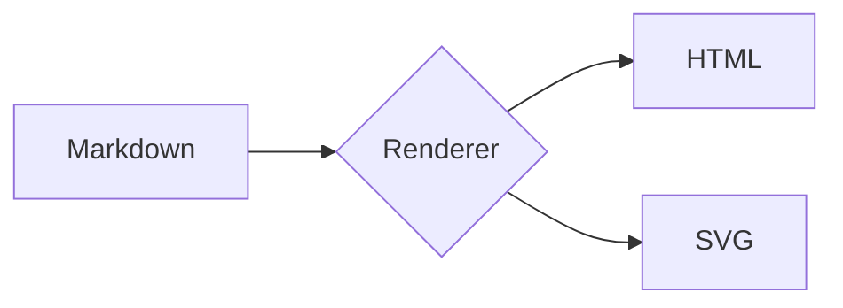
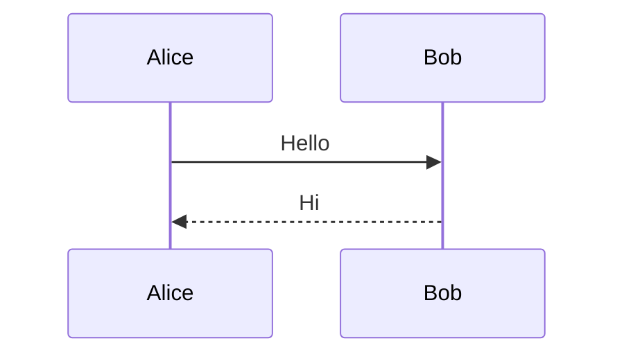
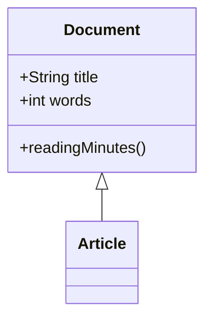
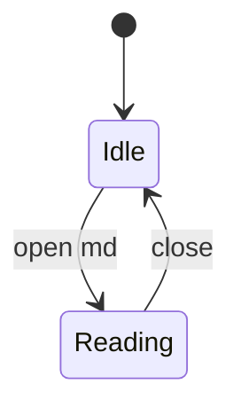

# Mermaid & Math 测试

## 流程图



## 时序图



## 类图



## 状态图



## 数学

行内：$\sum_{i=1}^{n} i = \frac{n(n+1)}{2}$

$$
\begin{aligned}
e^{i\pi} + 1 &= 0 \\
\int_0^1 x^2 \, dx &= \frac{1}{3}
\end{aligned}
$$

## 错误图表

```mermaid
this is not a valid diagram
```

## 代码

```javascript
const x = 42;
```
