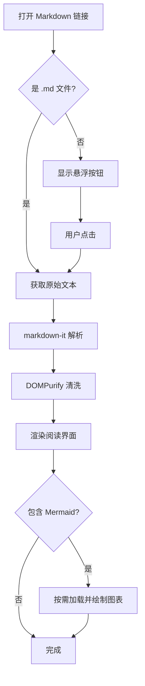
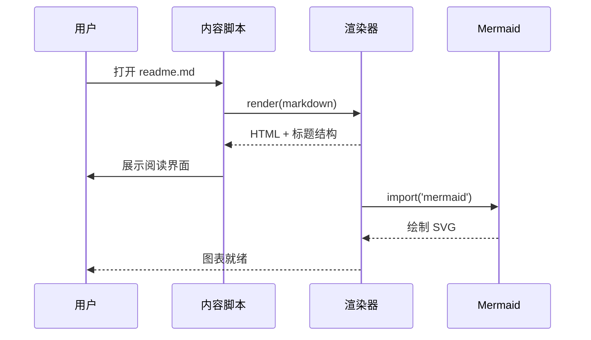
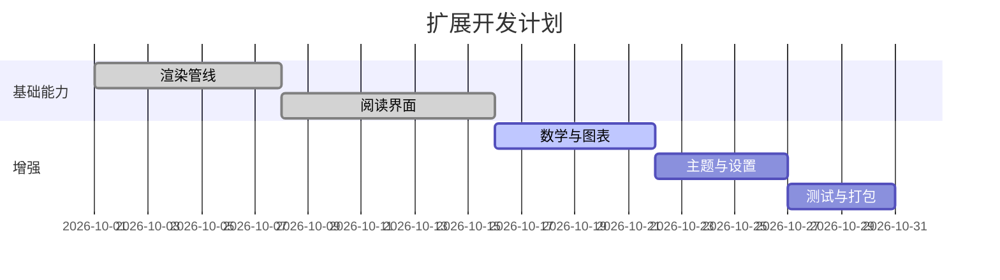

# MD Reader Pro 功能示例

> 这是一篇用来演示 **MD Reader Pro** 渲染能力的文档。它覆盖 CommonMark、GitHub Flavored Markdown，以及脚注、定义列表、数学公式、Mermaid 图表、代码高亮等扩展语法。
>
> 你可以直接在浏览器中打开本文件，或把任意 `.md` 文件拖进阅读器。

## 目录

[[toc]]

## 基础排版

### 标题与段落

这是普通段落。Markdown 的段落之间用空行分隔，行内可以混排 **加粗**、*斜体*、***加粗斜体***、~~删除线~~、`行内代码`，以及 [链接](https://commonmark.org)。

也可以使用 HTML 的 <kbd>Ctrl</kbd> + <kbd>K</kbd> 这样的按键样式（经过安全清洗后仍会保留）。

### 引用

> 好的文档应该像对话一样自然。
>
> > 嵌套引用用于补充说明或引用原文。
>
> —— 某位写文档的人

### 列表

- 无序列表
  - 嵌套一层
    - 嵌套两层
- 支持紧凑与宽松两种写法

1. 有序列表
2. 第二项
3. 第三项

任务列表：

- [x] 支持 GFM 任务列表
- [x] 复选框渲染为只读状态
- [ ] 待办事项会显示为空框

### 表格

| 语法 | 支持 | 说明 |
| :--- | :---: | ---: |
| 基础表格 | ✅ | 对齐方式 |
| 行内 `code` | ✅ | 代码样式 |
| 长文本换行 | ✅ | 自动换行与横向滚动 |
| 数学公式 | ✅ | 行内 $a^2+b^2=c^2$ |

### 分隔线

---

## 扩展语法

### 脚注

MD Reader Pro 支持脚注引用[^1]，也支持多个脚注[^longer]。

[^1]: 这是第一个脚注。
[^longer]: 脚注内容可以包含 **格式**、`代码`，以及[链接](https://example.com)。

### 定义列表

Markdown
: 一种轻量级标记语言，由 John Gruber 与 Aaron Swartz 创造。

CommonMark
: 一套严格定义的 Markdown 规范，拥有大量一致性测试。

GFM
: GitHub Flavored Markdown，在 CommonMark 基础上增加了表格、任务列表、删除线等。

### 缩写、上下标与高亮

HTML 由 W3C 维护，CSS 负责表现。<!-- abbr 定义见下方 -->

*[HTML]: HyperText Markup Language
*[CSS]: Cascading Style Sheets
*[W3C]: World Wide Web Consortium

- 水的化学式：H~2~O
- 爱因斯坦质能方程：E = mc^2^
- ==高亮文本== 与 ++插入文本++
- Emoji 短代码：:rocket: :sparkles: :coffee: :+1:

### GitHub Alerts

> [!NOTE]
> 有用的补充信息，读者可以快速扫过。

> [!TIP]
> 一个能让你更高效使用阅读器的小技巧。

> [!IMPORTANT]
> 阅读前必须了解的关键信息。

> [!WARNING]
> 可能会导致数据丢失或误操作的内容。

> [!CAUTION]
> 高风险操作，请谨慎处理。

### 自定义容器

::: tip 小提示
容器语法适合写提示、警告和补充说明。
:::

::: warning 注意
如果自定义 CSS 写错了，阅读器仍然可用，只是样式可能不符合预期。
:::

## 代码

### JavaScript

```js
// 计算阅读进度
function readingProgress(scrollTop, docHeight, viewportHeight) {
  const total = docHeight - viewportHeight;
  return total > 0 ? Math.min(1, Math.max(0, scrollTop / total)) : 0;
}

const progress = readingProgress(window.scrollY, document.body.scrollHeight, innerHeight);
console.log(`已阅读 ${(progress * 100).toFixed(1)}%`);
```

### TypeScript

```ts
interface RenderOptions {
  math: boolean;
  mermaid: boolean;
  frontMatter: 'card' | 'hide' | 'raw';
}

export function createRenderer(options: Partial<RenderOptions> = {}) {
  return { options, render: (markdown: string) => markdown };
}
```

### Python

```python
from dataclasses import dataclass

@dataclass
class Document:
    title: str
    words: int

    @property
    def reading_minutes(self) -> int:
        return max(1, round(self.words / 240))

doc = Document("Hello, Markdown", 1200)
print(f"{doc.title}: {doc.reading_minutes} min")
```

### Shell

```bash
# 构建扩展
npm install
npm run build

# 在 Chrome 中加载 dist/ 目录
open -a "Google Chrome" chrome://extensions
```

### Diff

```diff
- const renderer = new MarkdownIt();
+ const renderer = createRenderer({ math: true, mermaid: true });
```

### JSON

```json
{
  "name": "md-reader-pro",
  "version": "1.0.0",
  "features": ["GFM", "KaTeX", "Mermaid", "TOC"],
  "offline": true
}
```

## 数学公式

行内公式：当 $a \ne 0$ 时，方程 $ax^2 + bx + c = 0$ 的两个解为 $x = \frac{-b \pm \sqrt{b^2-4ac}}{2a}$。

块级公式：

$$
\int_{-\infty}^{\infty} e^{-x^2}\,dx = \sqrt{\pi}
$$

$$
\begin{aligned}
\nabla \cdot \mathbf{E} &= \frac{\rho}{\varepsilon_0} \\
\nabla \cdot \mathbf{B} &= 0 \\
\nabla \times \mathbf{E} &= -\frac{\partial \mathbf{B}}{\partial t} \\
\nabla \times \mathbf{B} &= \mu_0 \mathbf{J} + \mu_0 \varepsilon_0 \frac{\partial \mathbf{E}}{\partial t}
\end{aligned}
$$

矩阵：

$$
\begin{pmatrix}
a & b \\
c & d
\end{pmatrix}
\begin{pmatrix}
x \\
y
\end{pmatrix}
=
\begin{pmatrix}
ax + by \\
cx + dy
\end{pmatrix}
$$

## Mermaid 图表

### 流程图



### 时序图



### 甘特图



## 图片

下面是一张本地图片，用于演示相对路径解析与图片灯箱（点击可放大）：


带标题的图片会自动包成 `figure`：


## 长文阅读测试

### 为什么要用 Markdown

Markdown 的价值在于把内容和排版分开。你只需要关心段落、标题、列表和链接这些结构，具体长什么样交给阅读器决定。这样一来，同一份文档可以在 GitHub、编辑器、静态网站和浏览器扩展里保持一致的结构，而读者也能选择自己舒服的字号、宽度和主题。

对经常读技术文档的人来说，一个可靠的浏览器阅读器意味着：不必先下载文件，不必打开笨重的编辑器，也不必担心格式错乱。点开链接，正文、目录、公式和图表都在同一个页面里。

### 排版细节

中文排版需要合适的行高和字距。正文默认使用系统无衬线字体，长文可以切换到衬线体；行宽控制在 700–850px 之间，既不会让眼睛频繁换行，也不会因为行长过长而迷失。

> 阅读是一件私人的事。好的阅读器应该安静、快速，并且尊重读者的偏好。

代码块需要清晰的等宽字体、足够的对比度，以及一键复制；表格需要横向滚动而不是挤压内容；图片需要懒加载与放大；脚注需要可点击的往返链接。这些细节加起来，才构成“好用”。

## 链接与锚点

- [CommonMark 规范](https://spec.commonmark.org/)
- [GitHub Flavored Markdown](https://github.github.com/gfm/)
- [KaTeX 支持的函数](https://katex.org/docs/supported.html)
- [Mermaid 文档](https://mermaid.js.org/)

回到 [目录](#目录) 或 [顶部](#md-reader-pro-功能示例)。

---

**提示**：这篇文档本身就是用 Markdown 写的。点击工具栏上的 `</>` 按钮，可以随时查看它的源码。
