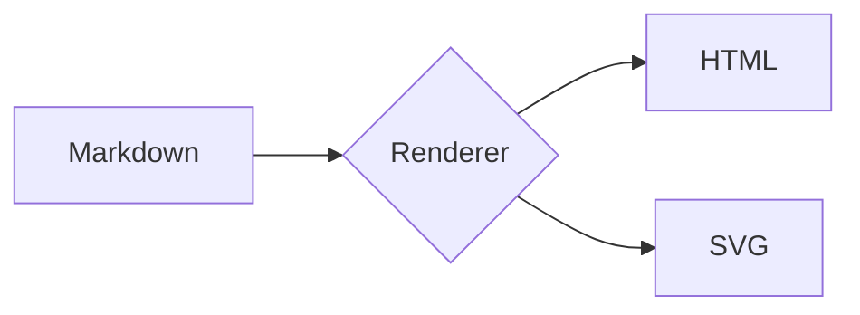

# MD Reader Pro — 渲染器综合示例

这篇文档同时作为 `test/render/` 的人工验收样例：用 `test/render/harness.html`
打开它，可以看到渲染器输出的全部 DOM 契约（表格、代码、图表、提示、图片、脚注……）。

[[toc]]

## 基础排版

### 强调与行内代码

普通段落混排 **加粗**、*斜体*、~~删除线~~、`inline code` 与 [链接](https://commonmark.org)。

### 嵌套引用

> 外层引用。
>
> > 内层引用，用来验证嵌套 blockquote 的间距。

### 列表

- 无序列表
  - 嵌套一层
    - 嵌套两层
1. 有序列表
2. 第二项

任务列表：

- [x] 渲染器支持 GFM 任务列表
- [x] 复选框只读
- [ ] 还有未完成项

## 表格

| 左对齐 | 居中 | 右对齐 |
| :--- | :----: | ----: |
| 普通单元格 | ✅ | 1 |
| 行内 `code` | **加粗** | 2 |

## 代码

```js
function readingProgress(scrollTop, docHeight, viewportHeight) {
  const total = docHeight - viewportHeight;
  return total > 0 ? Math.min(1, Math.max(0, scrollTop / total)) : 0;
}
```

```python
from dataclasses import dataclass

@dataclass
class Document:
    title: str
    words: int
```

```bash
npm install
npm run build
```

```json
{ "name": "md-reader-pro", "offline": true }
```

```diff
- const renderer = new MarkdownIt();
+ const renderer = createRenderer({ math: true });
```

```unknown-language
<div>这段内容必须原样转义显示</div>
```

## 数学

行内公式 $a^2 + b^2 = c^2$ 与 `\(x + y\)`。

$$
\int_{-\infty}^{\infty} e^{-x^2}\,dx = \sqrt{\pi}
$$

\[
\begin{pmatrix} a & b \\ c & d \end{pmatrix}
\]

## 图表



## 提示与告警

> [!NOTE]
> GitHub 风格提示。

> [!TIP]
> 更省事的用法。

> [!IMPORTANT]
> 关键信息。

> [!WARNING]
> 需要小心。

> [!CAUTION]
> 高风险操作。

::: tip 小提示
容器语法适合写补充说明。
:::

::: warning 注意
自定义容器与 Alerts 复用同一套样式。
:::

::: danger 危险操作
这一块使用 danger 类型。
:::

## 图片


行内图片  会保持在段落内。

## 脚注

脚注引用[^1]，以及较长的一条[^long]。

[^1]: 第一条脚注。
[^long]: 脚注里可以包含 **格式**、`代码` 与[链接](https://example.com)。

## 定义列表与扩展语法

Markdown
: 一种轻量级标记语言。

CommonMark
: 一套严格定义的 Markdown 规范。

*[HTML]: HyperText Markup Language

HTML、H~2~O、E = mc^2^、==高亮==、++插入++、:rocket:、<kbd>Ctrl</kbd> + <kbd>K</kbd>。

<details>
<summary>可折叠的原始 HTML</summary>

`<details>` / `<summary>` 会被保留。

</details>

## 结束

[[toc]] 可以出现在任意位置。
